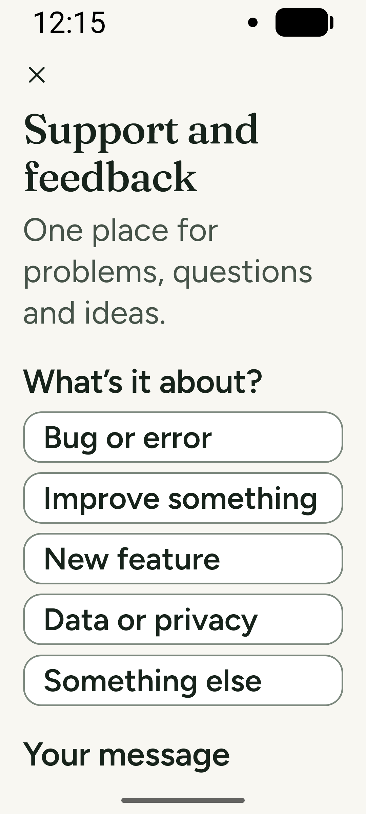
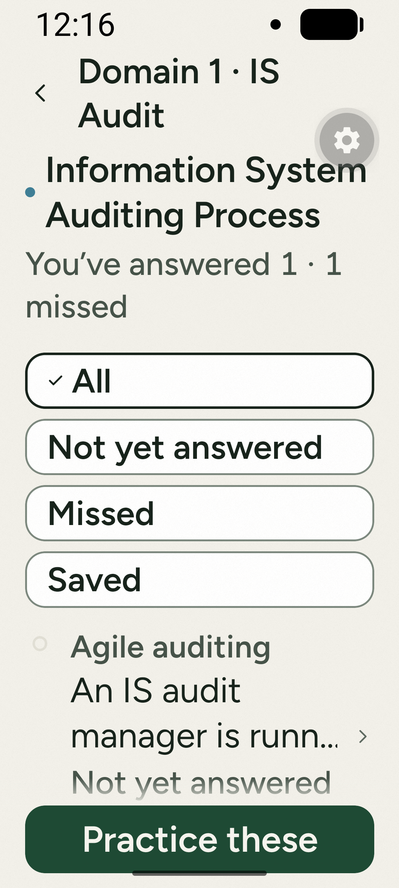
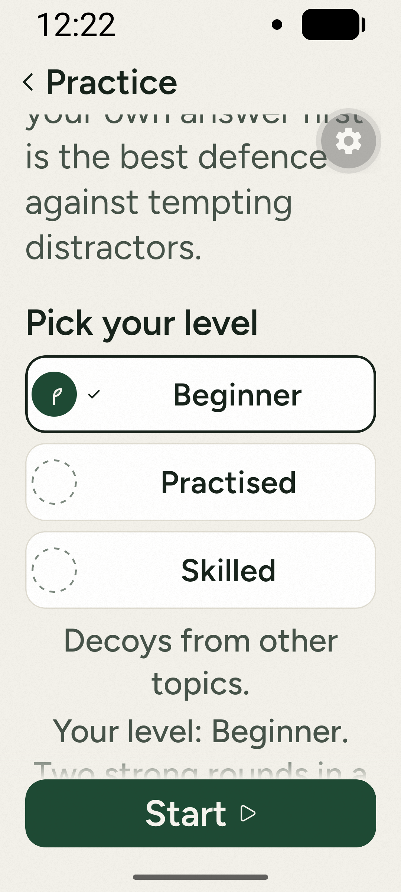

# App-wide text fit audit

10 November 2026 · PR #242 · mobile development version 2.3.0.

The reported “Tool before” label was native text clipping: its complete label is “Tool before policy”. The follow-up audit reviewed shared controls and reading surfaces across the mobile app. Existing Learn title/navigation cards, course content, grading, saved progress and actions are unchanged.

## Corrections

- Mistake and report choices have stable full-width labels. Large-text filter groups use rounded rows that grow with their text.
- Buttons stay within their available width. Numeric selectors stack when their measured width cannot comfortably hold the numeral and unit.
- Empty-state teaching labels and principle trigger labels have room to wrap.
- Note breadcrumbs and lesson captions retain their complete text. The compact answer recap retains the answer letter and has space for a second line.
- Drill level choices stack at enlarged text sizes; ordinary three-tile controls and small decorative markers retain their existing layout.
- Staff moderation displays the full already-fetched text, which previously had line limits without an expansion action. Permissions, fetched data and moderation actions are unchanged.

Intentional question/list previews, collapsed duplicate reading titles and horizontally scrollable filters remain compact; their full content is available through the existing interaction.

## Verification

- Full `npm run check`: 359 suites and 7,156 tests passed; two pre-existing skips. Typecheck and lint passed.
- Final Android export passed. Repository health passed with its npm lint dependency available.
- Independent source/UX reviews found no blocking issues, including a separate review of the final drill correction.
- `SHOTS=textfit` uses isolated synthetic data, blocks outbound services and inspects text bounds across main navigation, study readers, practice, settings, support sheets, empty states and all drill entrances. The scanner distinguishes scrollable content and deliberate previews from clipping. CSS text zoom is an approximation, not a native-layout guarantee.
- The final focused screenshot pass covered 52 cases: all nine drill entrances, both question-count choosers, the answer recap and You, across light/dark and 393px normal/320px enlarged text. All passed with zero clipping candidates or runtime errors. Eight raw numeral font-box observations were retained and visually reviewed as readable, unclipped font metrics. Both choosers retain the complete “10 questions” label.
- Native Android verification covered support choices, question-bank filters and drill labels at 320dp with actual 200% system text. Mistake labels were also checked at normal and enlarged native text. Original 420dpi and 1.0 font scale were restored, with the emulator returned to Mistakes. No report was submitted and learner progress was not reset.

Authenticated cloud screens received source and automated-test review, not a signed-in device walkthrough. Native iOS, VoiceOver and TalkBack interaction were not tested. No production/store update or merge is included.

## Native proof

These are Android development-client captures at 320dp and 200% system text.

| Support choices | Question-bank filters | Drill levels |
|---|---|---|
|  |  |  |

## Owner check

1. In Mistakes, open **Change** or **Tag why you slipped**. Confirm **Tool before policy** is complete.
2. Open Help → Support and feedback and inspect the category choices. Close without sending.
3. Increase the device font size, then inspect Question bank filters and a drill's level choices. They should grow or stack, with all labels readable.
4. Return the font size to normal. Confirm Learn's title cards retain their original design.
