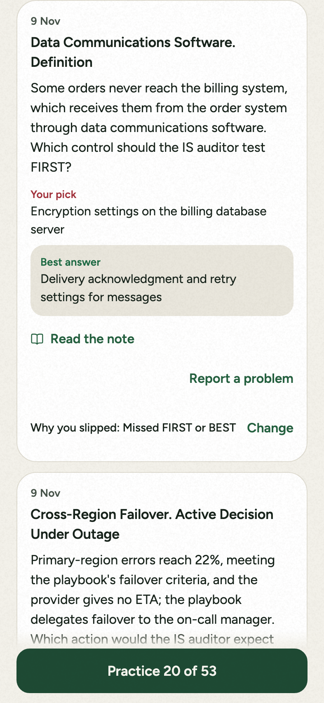
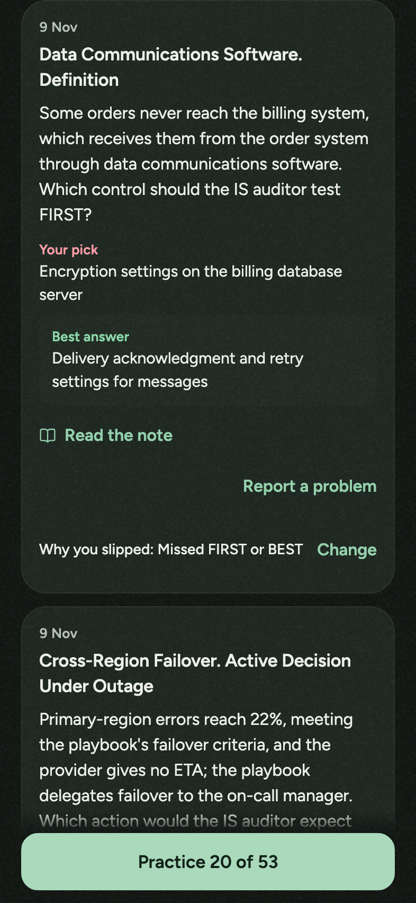
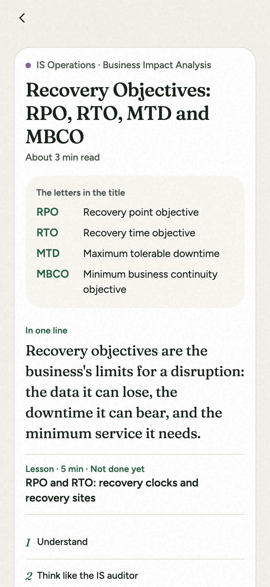
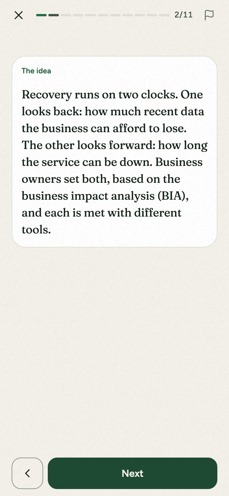
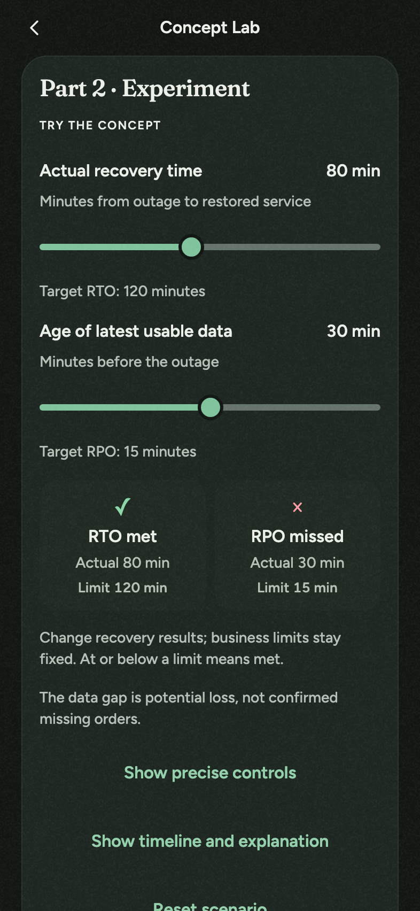
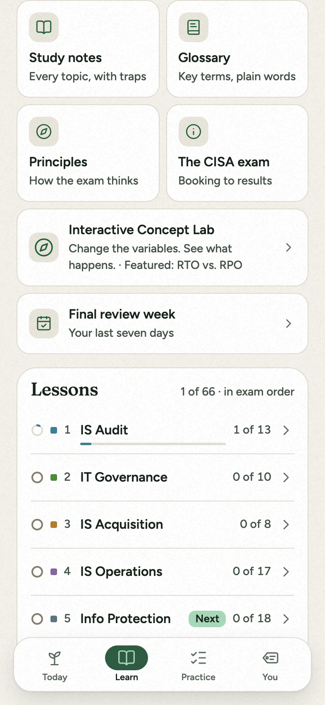
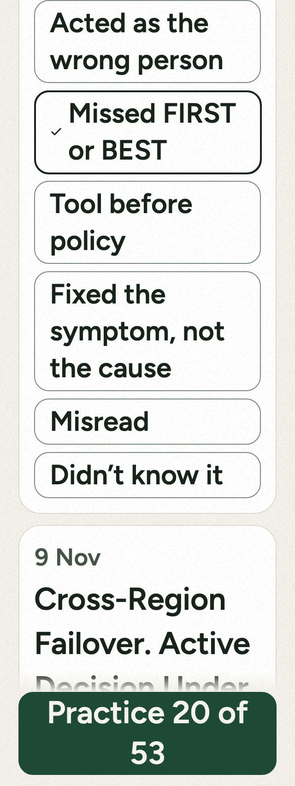

# One-topic reading cards

Owner-approved design, 9 November 2026. PR #242.

Each mistake, study note, principle, lesson content scene, and Concept Lab stage has one bounded Grove reading surface. Learn navigation/title tiles and lesson covers retain their existing design. No course content, grading rules, progress storage or dependencies changed.

Figures use the measured card interior, capped at the existing 560pt reading measure. Note/principle collapsed titles, note read thresholds and lesson answer scrolling include the card inset. The card itself does not group its interactive descendants into one accessibility element.

## Verification

- `npm run check`: 359 suites, 7,145 tests passed; 2 pre-existing skips.
- Android export and `scripts/verify_repo.sh`: passed.
- Independent mobile UX and QA/code review: no blocking findings.
- Existing Study notes screenshot/navigation harness: passed, no browser runtime errors.
- `SHOTS=topics npm run shots`: all eight combinations of light/dark, 320/393px and normal/200% text approximation passed; 72 screenshots. Checks complete mistake content, answer labels, tagging, note navigation/section jumps/diagrams, principle text, preserved lesson cover, lesson body and lab controls.
- The matrix found a tag-help button extending outside its card at 320px/200%. Constraining its width and allowing shrink fixed it; all eight combinations passed afterward. Focused mistake/tag-focus tests and lint passed again.
- Visual review found capsule borders crossing multiline tags; the owner also reported native clipping of “Tool before policy”. Mistake tags now opt into full-width rounded rows with a stable label width. Other chips retain their existing appearance. All eight configurations passed again, and native normal/200% text screenshots confirm all six complete labels. The full suite passed after the corner change; typecheck, lint and focused mistake/tag-focus tests passed again after the native width fix.
- Native Android development client: checked Mistakes in light/dark and actual 200% system font size, note navigation and section jump, Concept Lab, unchanged Learn tiles, lesson cover and content scene. Restored original light theme and 1.0 font scale. Existing learner progress was not reset. TalkBack interaction and iOS native verification were not performed.

## Screenshots

The images below use isolated synthetic screenshot data. The emulator retains its existing learner data.

| Mistakes, light | Mistakes, dark |
|---|---|
|  |  |

| Study note | Lesson content |
|---|---|
|  |  |

| Concept Lab | Preserved Learn title cards |
|---|---|
|  |  |

No store build, production update or merge is included in this preview. The development version is 2.3.0; the requested store version remains tracked separately in RELEASE_2_1.md.
